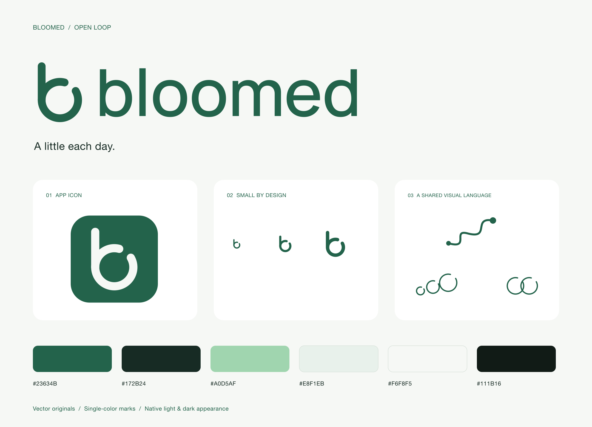

# Bloomed · Open loop



A lowercase **b** with an open bowl: the name first, a walking path in the background. The open curve also provides a consistent vocabulary for the route, growing loops, and paired-support artwork.

The production artwork is precise vector geometry. The wordmark is outlined Manrope at weight 550 with adjusted spacing; no font needs to be installed to use these SVGs or PDFs. Interface text remains the native system font. Manrope's source and [SIL Open Font License](source/OFL-Manrope.txt) are included. [Upstream font source](https://github.com/google/fonts/tree/main/ofl/manrope).

## Files

Each artwork has a self-contained **SVG**, a vector **PDF**, and a high-resolution **PNG** in `exports/`.

| Asset | Use |
|---|---|
| `bloomed-lockup-moss` | Main logo on light surfaces; transparent PNG |
| `bloomed-lockup-paper`, `bloomed-lockup-sage` | Reversed logo on dark/moss surfaces |
| `bloomed-mark-moss`, `bloomed-mark-paper`, `bloomed-mark-sage` | Standalone mark |
| `bloomed-app-icon` | Full-square, opaque 1024 px icon; the OS supplies its corner mask |
| `walking-route` | Getting started / first walking plan |
| `growing-loops` | Empty progress state; decorative, not a data chart |
| `support-pair` | Future supporter or invitation illustration |
| `bloomed-brand-sheet` | Overview for review or sharing |

The app consumes PDF vectors through its asset catalog. Template rendering uses the existing adaptive `accent` color, so the same art naturally switches from moss in light mode to sage in dark mode. The app icon uses warm-white artwork on moss. Assets are installed in the Today header, walking/progress empty states, Settings, and shared summaries. The paired-support motif is available for later use without adding extra decoration to the current agreement form.

## Palette and use

- Moss `#23634B`: primary identity and icon background.
- Warm white `#F6F8F5`: canvas and reversed artwork.
- Ink `#172B24`: reading text.
- Sage `#A0D5AF`: identity on dark surfaces.
- Pale green `#E8F1EB`: secondary surfaces.
- Deep green `#111B16`: dark canvas.

Keep at least one mark-stroke of clear space around the standalone symbol. Use the supplied lockup proportions, never stretched. Use one color for the mark and wordmark. Keep illustration secondary to the main action, at about 120×72 points in the app. Do not use the artwork to convey verified activity, payments, success/failure, or precise progress. Use native interface symbols for navigation and controls.

The logo has one open bowl; keep that opening clear at small sizes. It is drawn to remain readable at 24 points. Use the standalone mark rather than shrinking the full wordmark into a tiny navigation icon.

## Rebuild

On macOS, from the repository root:

```sh
swift scripts/GenerateBrand.swift
```

The script reads the bundled licensed typeface, generates outlined SVG/PDF/PNG exports, refreshes vector image sets, and writes the app icon. It fails if the intended logo typeface cannot be loaded instead of substituting a system face. No network call or API key is needed to regenerate the production art.

An image-generation pass was used to explore the open-b direction; the [exact exploration prompt](source/exploration-prompt.txt) is preserved with the sources. The shipped assets are the subsequent code-drawn vector design; no generated bitmap is embedded in the interface. The exploration prompt requested a single moss-green open-b mark and lowercase wordmark, transparent background, flat geometry, careful spacing, and no botanical ornaments, gradients, or 3D effects. Tool mode: built-in image generation for exploration; Core Graphics/Core Text for production vector artwork.
